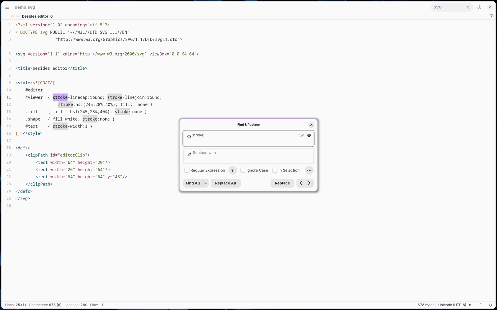
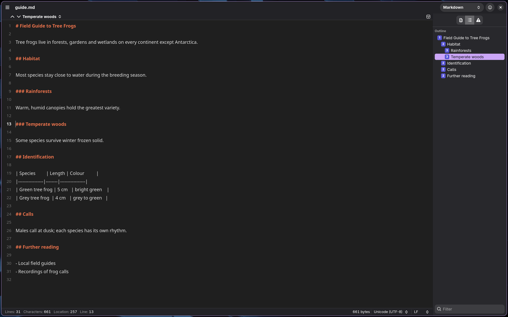

# Proza

A lightweight plain-text editor for Linux, built to look and work like
[CotEditor](https://coteditor.com) (macOS), written in Rust with GTK 4, libadwaita and GtkSourceView 5.




Proza is not affiliated with CotEditor. Its window layout, menus, settings and behaviour follow
CotEditor's; the themes are CotEditor's own (Apache-2.0, see `data/themes/NOTICE`).

## What it does

- **Windows like CotEditor's**: the document name, the syntax pop-up and the inspector button in the title
  bar; a navigation bar with the outline over each editor; a status bar with line / character / word
  counts (selection counts in brackets), the file size, and pop-ups for the text encoding and line endings.
- **All of CotEditor's menus** in one menu button, in CotEditor's order and with its shortcuts
  (⌘ becomes Ctrl).
- **Encodings and line endings**: detection in CotEditor's order (byte-order mark, the file's own
  declaration, then your priority list), Convert or Reinterpret when you change the encoding, warnings for
  characters the encoding can't hold and for inconsistent line endings. Typed and pasted line breaks always
  become the document's line ending.
- **Saving**: auto-save in place, crash backups for untitled documents, reload when another app changes
  the file (or ask, or keep yours).
- **Text commands**: comments, indentation, Surround, line commands (move, sort, reverse, shuffle, delete
  duplicates, duplicate, delete, join), case and width transformations, URL encoding, Unicode
  normalization, Go to Line (`3`, `-1`, `3:2`), Insert by Unicode Code Point.
- **Typing aids**: brackets and quotes in pairs, smart quotes and dashes per mode, the other occurrences of
  a selected word highlighted, word completion (F5).
- **Find & Replace panel**: incremental search, Find All with a result list, Highlight All, regular
  expressions with look-around and `$1` replacements, whole words, ignoring diacritics or width,
  search histories.
- **Split editors** (up to four, stacked or side by side) and an **outline** for about 40 syntaxes
  (headings, classes, functions, `MARK:` comments).
- **Inspector**: file information, counts, the selected character (name, block, category), the outline
  with a filter, and warnings. **Inspect Character** shows any character in detail.
- **Folder windows**: open a folder to get a file browser with New File / New Folder, rename, duplicate,
  move to trash, a filter, and previews of files that aren't text.
- **Settings** with CotEditor's nine panes, including a theme editor, per-syntax modes, snippets,
  file-drop rules, and editable shortcuts.
- **Scripts**: executable files in `~/.local/share/proza/scripts` appear in the Script menu and use
  CotEditor's `%%%{CotEditorXInput=…}%%%` / `%%%{CotEditorXOutput=…}%%%` headers; errors go to the Console.

## Not (yet) like CotEditor

GtkSourceView has a single selection per buffer, so there are no multiple cursors or column selections,
and split editors share one cursor. Also missing: spell checking, indent guides, hanging indents, vertical
text, printing, window tabs, the syntax definition editor, Sort by Pattern, Advanced Character Count,
Edit Color Code, Multiple Replace, Quick Actions, and the rmate server.

## Install

Needs Rust, GTK 4 (4.18+), libadwaita (1.7+) and GtkSourceView 5. On Arch Linux:

```sh
sudo pacman -S --needed rust gtk4 libadwaita gtksourceview5
bash tools/install-linux.sh
```

This builds Proza and installs `~/.local/bin/proza`, the launcher entry and the icon.
`bash tools/install-linux.sh --remove` removes them again.

## Command line

```sh
proza file.txt other.md      # open files
proza ~/Projects/site        # open a folder window
```

## Files

| Path | What |
|---|---|
| `~/.config/proza/settings.json` | settings |
| `~/.config/proza/themes/*.cottheme` | your themes and changed copies of the bundled ones |
| `~/.local/share/proza/scripts/` | scripts for the Script menu |
| `~/.local/state/proza/backups/` | crash backups of unsaved untitled documents |

## Licence

GPL-3.0-or-later. The bundled themes are CotEditor's (Apache-2.0); the Unicode block and version tables
come from the Unicode Character Database (Unicode License v3).
